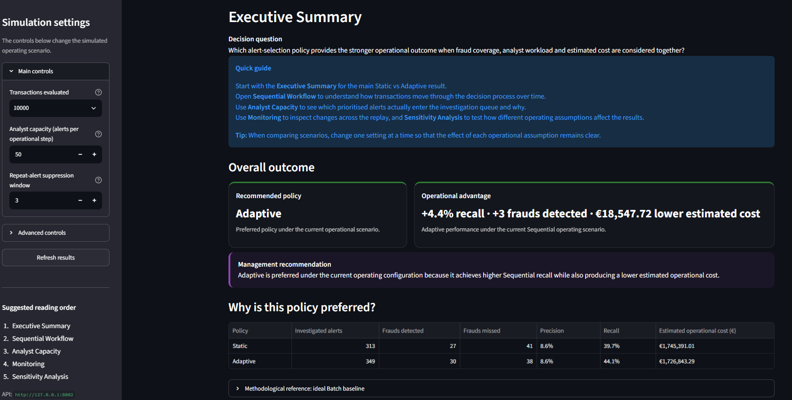
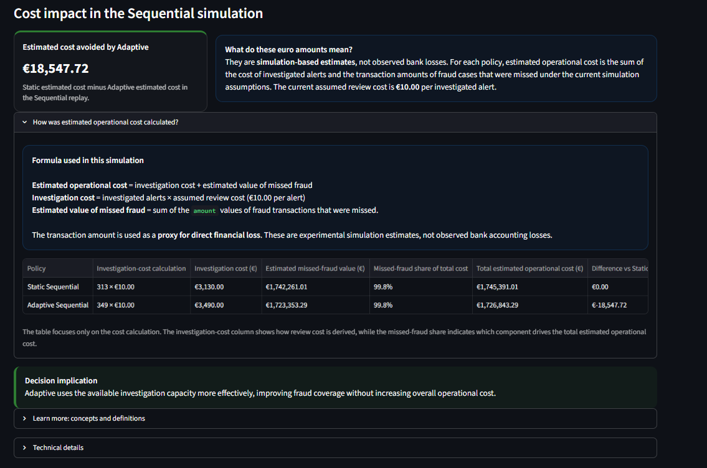
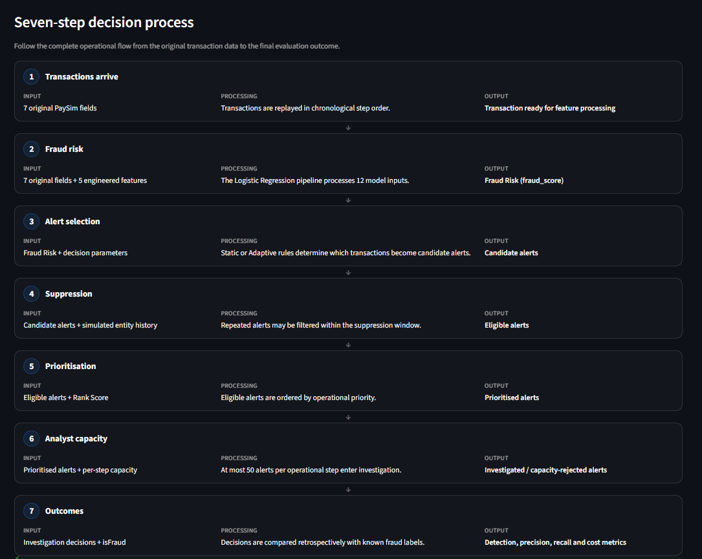
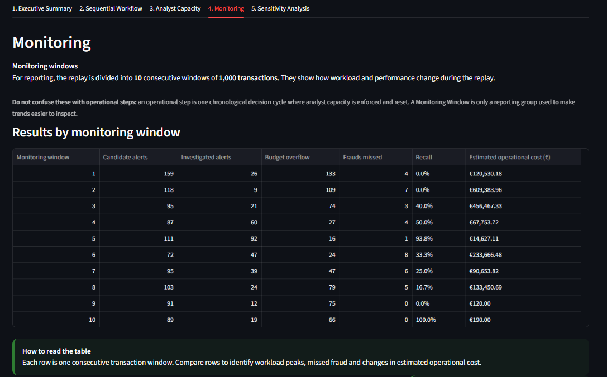
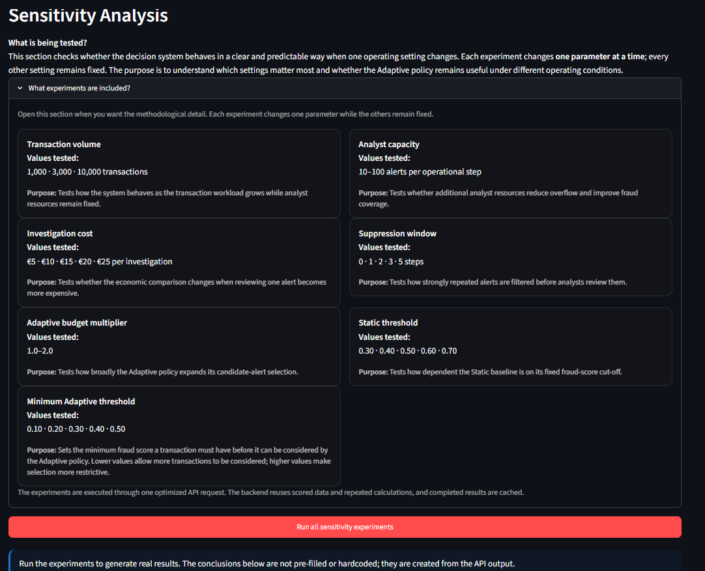

# Decision-Centric Fraud Detection Framework

**MSc Artificial Intelligence Dissertation | Python · Machine Learning · FastAPI · Streamlit**

A research prototype that turns fraud-risk predictions into **prioritised investigation decisions** under limited analyst capacity. Rather than stopping at classification accuracy, it examines which alerts are investigated, which are missed, and how different decision strategies affect workload and simulated operational cost.

**Looking for the SQL / Data Analyst side of this project?** Visit the companion **[Fraud Operations Analytics dashboard](https://github.com/alice-patrick/fraud-decision-analytics)** for transaction patterns, operational KPIs, investigation-capacity analysis and SQL reporting. **This repository** contains the model-scoring and decision-simulation system that supplies those results.

> **Research scope:** Synthetic PaySim transactions, offline chronological replay and hypothetical operational costs. This is **not** a live bank-fraud monitoring system. The previously hosted demonstration is currently offline; screenshots and local run instructions are available below.

## Results at a glance

Results for one **10,000-transaction sequential simulation**:

| Measure | Static baseline | Adaptive alternative |
| --- | ---: | ---: |
| Investigated alerts | 313 | 349 |
| Frauds detected | 27 | **30** |
| Frauds missed | 41 | **38** |
| Precision | 8.6% | 8.6% |
| Recall | 39.7% | **44.1%** |
| Estimated operational cost | €1,745,391.01 | **€1,726,843.29** |

**Observed trade-off:** Adaptive detected **3 additional frauds** (+4.4 percentage points of recall) and incurred **€18,547.72 less estimated operational cost**, while using **36 additional investigations** in this particular simulated scenario. These are **not realised banking savings**.

**Scenario settings:** 10,000 transactions; **50 investigations per operational step**; €10 assumed investigation cost; Static threshold 0.50; Adaptive risk floor 0.30; Adaptive budget multiplier 1.40; suppression window of 3 steps. The current API **defaults to 30** investigations per step, so an unconfigured API request will **not** reproduce this 50-slot scenario. Results also depend on using the same dataset sample and model.

## Dashboard preview

The Streamlit application has five views: **Executive Summary**, **Sequential Workflow**, **Analyst Capacity**, **Monitoring** and **Sensitivity Analysis**. The two images below show the central result and its operational implications.

### Executive Summary

A compact comparison of fraud detection, investigation workload and simulated costs for Static and Adaptive decision policies.



### Analyst Capacity — Static baseline

Operational alerts are separated into **investigated**, **suppressed** (repeat-alert rule) and **capacity-rejected** (eligible but without an available slot).


<details>
<summary><strong>See the full dashboard walkthrough and remaining screenshots</strong></summary>

### 1. Executive Summary — estimated cost impact

The comparison uses **estimated operational cost = investigation cost + estimated missed-fraud exposure**. Investigation cost is the number of reviews multiplied by the assumed cost per review; missed-fraud exposure uses the transaction amounts of undetected labelled frauds as a simulation proxy. It does **not** measure actual bank losses.



### 2. Sequential Workflow

The offline replay orders transactions chronologically, applies alert-selection rules, suppresses repeat candidates, ranks eligible alerts and enforces analyst capacity before retrospectively comparing decisions with fraud labels.



### 3. Analyst Capacity — Adaptive alternative

The same outcome categories are available for the Adaptive policy. In the reported 10,000-transaction scenario, the Static / Adaptive counts were **313 / 349 investigated**, **13 / 21 suppressed**, and **410 / 650 capacity-rejected** candidates. An investigation is not necessarily a detected fraud.


### 4. Monitoring

The replay is split into **10 consecutive reporting groups of 1,000 transactions**. These groups track investigations, missed fraud, recall and estimated costs. They are **not** calendar time periods; analyst capacity resets by operational step, not by reporting group.



### 5. Sensitivity Analysis

One-at-a-time experiments examine seven settings: transaction volume, analyst capacity, investigation cost, suppression window, Adaptive budget multiplier, Static threshold and Adaptive risk floor.



Across **45 reported comparisons**, Adaptive was preferred in **28**, Static in **11**, with **6 ties** under the study's preference rule (higher recall; lower estimated cost when recall is tied). These are configuration-dependent simulation results, not a universal superiority claim.


</details>

## What the framework implements

1. **Fraud-risk scoring:** Feature preprocessing and a calibrated Logistic Regression model produce transaction-level risk estimates.
2. **Decision policies:** A Static threshold baseline and an Adaptive cost-aware prioritisation strategy select candidate alerts.
3. **Sequential investigation simulation:** Repeat-alert suppression and per-step analyst capacity determine which candidates are investigated, suppressed or rejected.
4. **Evaluation and monitoring:** Outcomes are assessed retrospectively using known synthetic labels, workload measures, precision/recall and simulated cost.

The ML pipeline uses scikit-learn preprocessing (`ColumnTransformer`, scaling and one-hot encoding), Logistic Regression and probability calibration. A **FastAPI** backend provides simulation and evaluation results to the **Streamlit** interface.

**Companion reporting layer:** [Fraud Operations Analytics](https://github.com/alice-patrick/fraud-decision-analytics) imports the Main Framework's sequential results into SQLite and uses SQL (`JOIN`s, CTEs and window functions) for business-focused reporting. It **does not** retrain the model or recalculate the Main's decision outcomes.

## Technology stack

**Python · pandas · NumPy · scikit-learn · FastAPI · Uvicorn · Streamlit · Matplotlib · pytest · Git/GitHub**

## Run locally (Windows CMD)

From the **Main Framework repository root**:

```cmd
py -m venv .venv
.venv\Scripts\activate.bat
python -m pip install -r requirements.txt
python -m pip install -r app\requirements.txt
```

The application looks for the full PaySim dataset at `data/raw/AIML Dataset.csv` when present, otherwise it can use the included deployment sample at `data/deployment/paysim_deployment_sample.csv`. The exact evaluation results depend on which dataset/model version is used.

**Terminal 1 — start the API:**

```cmd
python -m uvicorn app.api.main:app --host 127.0.0.1 --port 8002
```

**Terminal 2 — start the Main Streamlit dashboard:**

```cmd
.venv\Scripts\activate.bat
python -m streamlit run app/ux_evaluation_dash.py
```

Open the local dashboard at `http://localhost:8501` and the API documentation at `http://127.0.0.1:8002/docs`. These are **local-only addresses**, not public demo links.

### Reproducing the published scenario settings

The sequential endpoint is **`GET /simulation/sequential`**. In the API documentation, set at least the following parameters for the published 10,000-transaction, 50-slot comparison:

| Parameter | Value |
| --- | ---: |
| `limit` | `10000` |
| `alert_budget_per_step` | `50` |
| `investigation_cost` | `10` |
| `static_threshold` | `0.5` |
| `risk_zone_floor` | `0.3` |
| `budget_multiplier` | `1.4` |
| `suppression_window` | `3` |
| `monitoring_window_size` | `1000` |

The current API default for `alert_budget_per_step` is **30**, so explicitly set **50** for this published example. Matching the settings alone does not guarantee identical numbers if the underlying PaySim sample or model differs. This is a **sequential** comparison; do not mix its results with batch-only evaluations.

## Testing and limitations

Run the repository's tests in your local environment:

```cmd
python -m pytest
```

Earlier project documentation reported 88 passing automated tests; that number has **not been re-verified for the current revision**.

**Limitations:** PaySim is synthetic; replay is offline rather than live streaming; analyst-capacity and suppression assumptions are simplified; labels are used for retrospective assessment; and costs are simulation estimates, not observed losses.

## Main contribution

The contribution is the **decision layer between ML risk scores and operational investigation actions**: candidate selection, prioritisation, limited review capacity, repeat-alert suppression and measurable trade-offs. For the downstream **SQL and Data Analyst portfolio component**, see [Fraud Operations Analytics](https://github.com/alice-patrick/fraud-decision-analytics).
