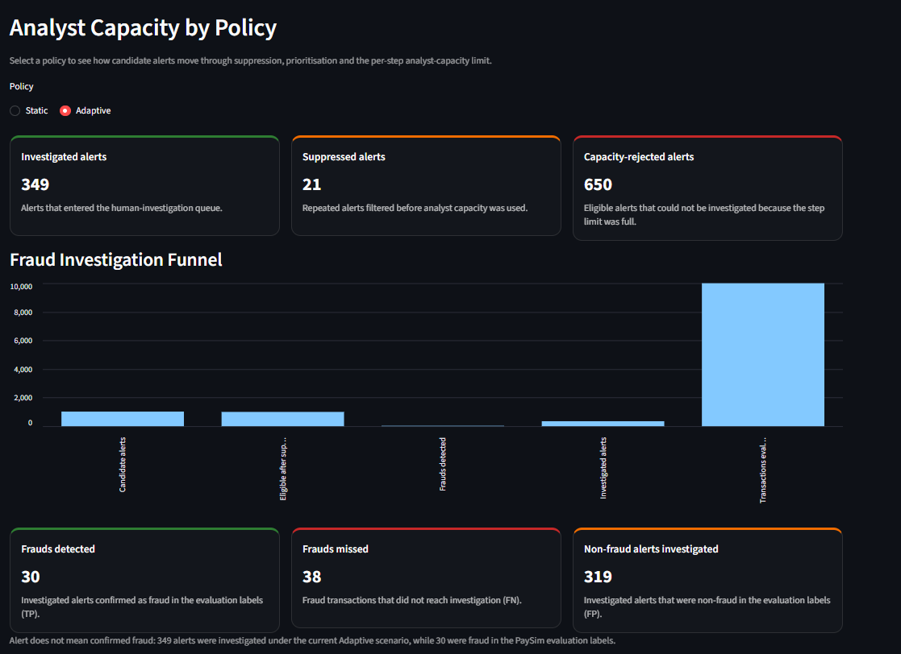
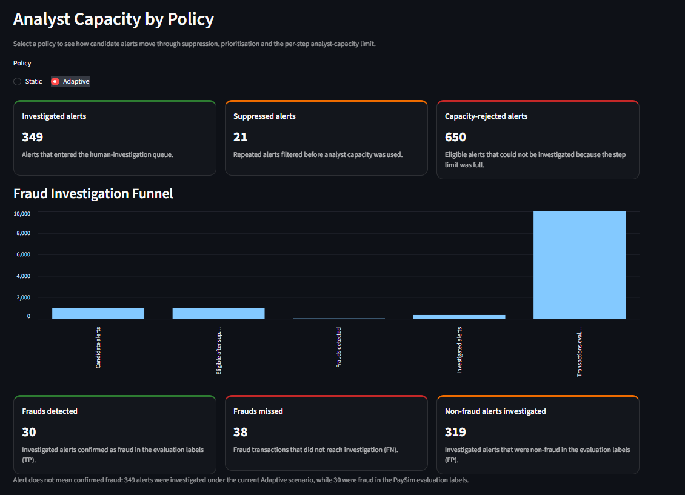
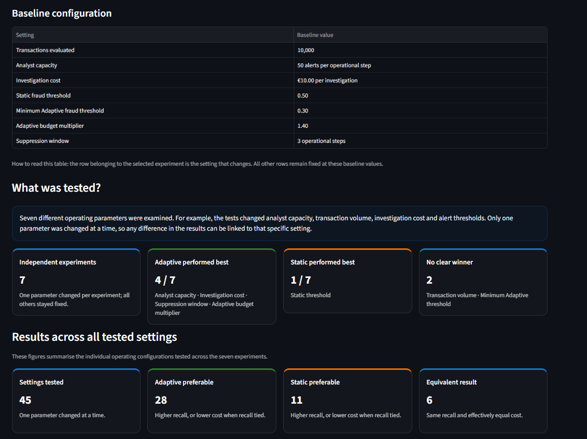

# Decision-Centric Fraud Detection Framework

**MSc Artificial Intelligence Dissertation | Python · Machine Learning · FastAPI · Streamlit**

An end-to-end research prototype that turns fraud-risk predictions into **prioritised investigation decisions** under limited analyst capacity. Rather than evaluating classification accuracy alone, it compares **Static and Adaptive alert-selection policies** using fraud detection, analyst workload and simulated operational cost.

> **Research scope:** Synthetic PaySim transactions, offline chronological replay and simulation-based cost estimates. This is not a live banking or production fraud-monitoring system. The hosted demo is currently offline; screenshots and local run instructions are provided below.

## At a glance

| Evaluation | Static | Adaptive |
| --- | ---: | ---: |
| Investigated alerts | 313 | 349 |
| Frauds detected | 27 | 30 |
| Frauds missed | 41 | 38 |
| Recall | 39.7% | **44.1%** |
| Estimated operational cost | €1,745,391.01 | **€1,726,843.29** |

**Baseline:** 10,000 transactions, 50 investigations per operational step, Static threshold 0.50, Adaptive minimum risk threshold 0.30. In this scenario, Adaptive detected **3 additional frauds** and reduced *estimated* operational cost by **€18,547.72**. These are simulation results, not realised bank savings.


## Dashboard walkthrough

The Streamlit interface has five views, covering policy performance, sequential decisions, analyst workload, monitoring and parameter sensitivity.

### 1. Sequential workflow

Transactions are replayed chronologically, with repeat-alert suppression and analyst-capacity limits applied within each operational step.


### 2. Analyst capacity and investigation decisions

The dashboard separates **investigated**, **suppressed** and **capacity-rejected** alerts, making operational trade-offs visible. For the Adaptive baseline, 349 alerts were investigated, 21 suppressed and 650 rejected due to capacity limits.



<details>
<summary>Additional analyst-capacity detail</summary>



</details>

### 3. Monitoring

Ten consecutive reporting windows show changes in workload, missed fraud and estimated cost during the offline replay. These reporting windows are distinct from operational steps.


### 4. Sensitivity analysis

Seven operating parameters were examined one at a time. Across **45 tested settings**, Adaptive was preferred in **28**, Static in **11**, with **6 equivalent results**. This illustrates that policy performance depends on the operating conditions rather than one strategy always winning.


<details>
<summary>Additional sensitivity-analysis results</summary>



</details>

### 5. Estimated cost impact

Estimated operational cost combines assumed investigation costs and the transaction amounts of missed fraud cases as a proxy for potential loss. It is intended for **comparative simulation**, not as an estimate of observed banking losses.

<details>
<summary>View cost calculation and comparison</summary>


</details>

## How the system works

```text
PaySim transactions
    ↓
Feature engineering & preprocessing
    ↓
Logistic Regression + probability calibration
    ↓
Fraud-risk scores
    ↓
Static threshold / Adaptive cost-aware ranking
    ↓
Repeat-alert suppression
    ↓
Per-step analyst-capacity constraint
    ↓
Investigation queue and operational evaluation
```

- **ML pipeline:** scikit-learn `ColumnTransformer`, scaling, one-hot encoding, Logistic Regression and probability calibration.
- **Decision layer:** Static risk threshold versus Adaptive eligibility, expected-benefit ranking and alert budget.
- **Operational replay:** Chronological PaySim steps, repeat-alert suppression and capacity-constrained investigations.
- **Evaluation:** Precision, recall, missed fraud, workload, estimated cost and sensitivity analysis.
- **Interface/API:** Streamlit dashboard with a separate FastAPI backend.

## Technology stack

**Python · pandas · NumPy · scikit-learn · FastAPI · Uvicorn · Streamlit · Matplotlib · pytest · Git/GitHub**

## Run locally

From the repository root on Windows (Command Prompt):

```cmd
py -m venv .venv
.venv\Scripts\activate.bat
python -m pip install -r requirements.txt
python -m pip install streamlit
```

Place the PaySim dataset at `data/raw/AIML Dataset.csv` if it is not already present. Start the backend:

```cmd
python -m uvicorn app.api.main:app --reload --port 8002
```

In a **second terminal**, activate `.venv` again and start the UX dashboard:

```cmd
.venv\Scripts\activate.bat
python -m streamlit run app/ux_evaluation_dash.py
```

Open `http://localhost:8501`. API documentation is available at `http://127.0.0.1:8002/docs` while the backend is running.

## Testing and limitations

The project README previously documented **88 passing automated tests** covering decision logic, analyst capacity, sequential simulation, API behaviour and dashboard calculations. Re-run the test suite in your local environment to verify the current revision:

```cmd
python -m pytest
```

**Limitations:** Synthetic rather than real bank data; offline replay rather than live streaming; simplified analyst-capacity and suppression assumptions; retrospective fraud labels; and hypothetical operational costs.

## Main contribution

The key contribution is the **decision layer between ML predictions and investigation actions**: it makes alert eligibility, prioritisation, workload constraints and trade-offs inspectable, instead of treating the classifier score as the final operational decision.
